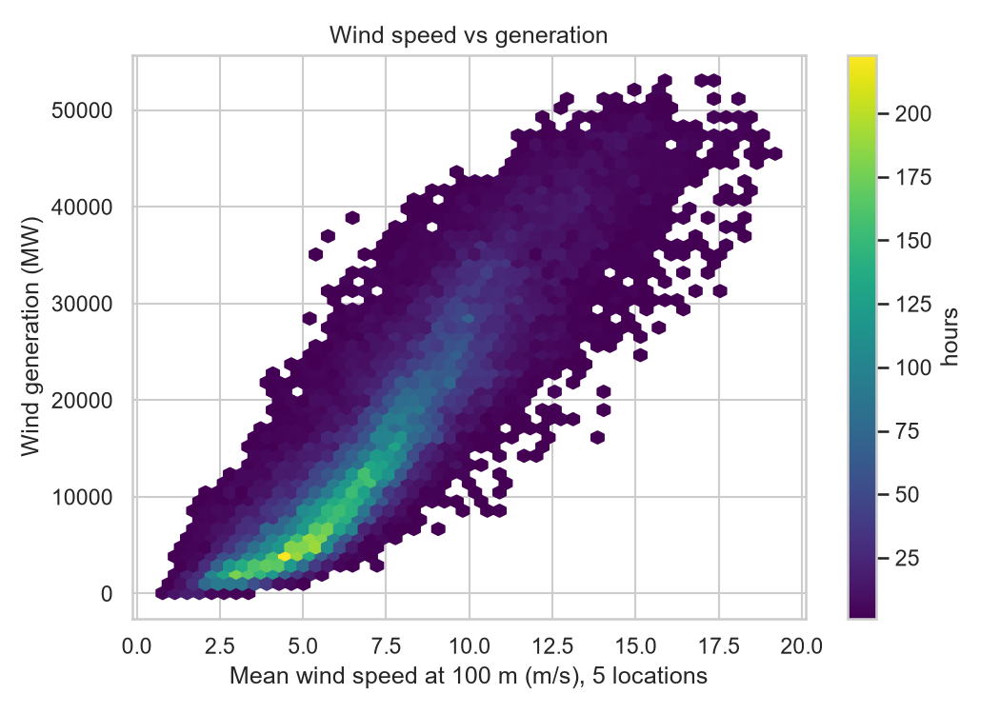
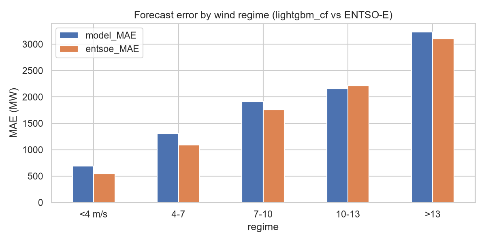
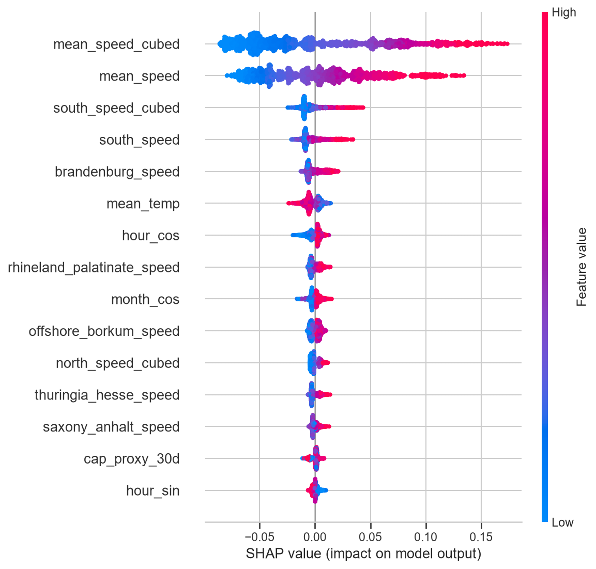
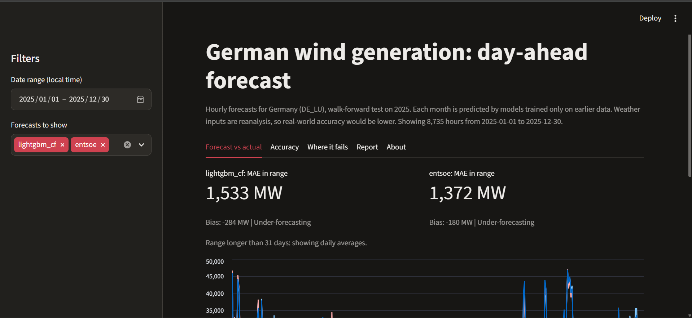

# Day-ahead wind generation forecast for Germany

Hourly forecasts of German wind generation (bidding zone DE_LU), built to be validated the way a trading team would
check them: walk-forward, no leakage, and compared honestly against ENTSO-E's own day-ahead forecast.

**Headline result (2025 test year, 8,735 hours):** the final model's MAE is **83.7% lower than a naive baseline** and
**11.8% higher than ENTSO-E's forecast**. It beats ENTSO-E in 2 of 12 months (January and February). It does not
beat ENTSO-E overall, and the weather inputs are reanalysis, so real-world accuracy would be lower (see Limitations).

## Results

Walk-forward test, every method scored on the same hours. Bias = forecast minus actual (negative = under-forecast).

| Method | MAE (MW) | wMAPE (%) | Bias (MW) |
|---|---|---|---|
| Seasonal naive (same hour last week) | 11,492 | 75.7 | -176 |
| Naive (same hour two days ago) | 9,400 | 61.9 | 5 |
| Ridge | 2,372 | 15.6 | -990 |
| Random forest | 1,923 | 12.7 | -1,198 |
| LightGBM | 1,855 | 12.2 | -1,169 |
| XGBoost | 1,870 | 12.3 | -1,173 |
| **LightGBM, capacity-factor target (final)** | **1,533** | **10.1** | **-284** |
| XGBoost, capacity-factor target | 1,543 | 10.2 | -257 |
| ENTSO-E day-ahead forecast | 1,372 | 9.0 | -180 |

## Project Visualizations

### Wind Power Curve


### Model Error by Wind Regime


### SHAP Feature Importance


### Streamlit Dashboard Preview



## What I found

1. **Weather coverage mattered most.** Going from 5 to 16 weather locations (plus regional averages and a capacity
   proxy) cut LightGBM's MAE from 2,544 to 1,855 MW (-27%). Several things changed at once, so I cannot say which one
   helped; an ablation test would answer that.
2. **Capacity growth mattered.** Installed wind capacity grew about 4% in 2023-24 and 6% in 2024-25 (65.9, 68.5 and 72.6 GW at the start of 2023, 2024 and 2025, from ENTSO-E). Predicting capacity factor (generation divided by installed capacity) and scaling back reduced the model's average under-forecasting bias from -1,169 to -284 MW and reduced MAE by 17%.
3. **A data artifact in the benchmark.** Three single-hour dips in ENTSO-E's forecast fall on the hour clocks change
   in October. Neighbouring hours were normal, so they were treated as artifacts and removed. This slightly
   favours ENTSO-E, not my model.
4. **Negative prices go with over-forecasting.** In the 576 negative-price hours both forecasts were too high
   (+1,639 MW for the model, +1,962 MW for ENTSO-E); in other hours both were too low. This is consistent with wind farms
   being curtailed when power is oversupplied. It is evidence of a pattern, not proof of the cause.
5. **Where the model is weak.** Compared with ENTSO-E, its error is about 26% higher below 4 m/s, 20% higher at 4-7 m/s,
   8% higher at 7-10 m/s and roughly level at 10-13 m/s. Seven of the model's eight largest misses fall on three
   weekend days (22 March, 30 March, 8 June), when the forecast was about 12-16 GW too high; the four hours I checked
   had negative prices. The eighth is the morning of 1 January.

## Method

- **Data:** actual wind generation, ENTSO-E's day-ahead wind forecast, day-ahead prices and installed capacity from
  the ENTSO-E Transparency Platform; hourly weather at 16 locations from the Open-Meteo historical archive.
- **Forecast set-up:** the forecast for day D is made around midday on D-1. Every feature built from past generation
  is lagged by at least 36 hours, so nothing from the future leaks in.
- **Cleaning:** one UTC hourly timeline (avoids daylight-saving duplicates), plausibility limits, interpolation of gaps
  up to 3 hours with a flag, and automated Pytest checks on the cleaned table.
- **Validation:** each month of 2025 is predicted by models trained only on data ending two days before that month
  (expanding window). No random splits.
- **Models compared:** Ridge, random forest, LightGBM, XGBoost, two naive baselines and ENTSO-E. LightGBM and XGBoost
  were within about 1% of each other (the random forest was about 4% behind), so LightGBM was chosen mainly for speed.
- **Explainability and error analysis:** SHAP, error by wind regime, ramps, hour of day and price sign
  (`src/analysis.py`).
- **LLM-assisted report:** `src/llm_report.py` computes every figure with pandas, then asks an LLM (Groq by default,
  Ollama supported, plain template as fallback) to write the summary. A number check flags any figure in the text that
  is not in the source facts, and the code precomputes comparisons so the LLM does not judge raw numbers itself.
- **Dashboard:** `streamlit run app/streamlit_app.py`.

## Limitations

- Weather inputs are reanalysis (what actually happened), not archived forecasts. A real day-ahead forecaster only has
  forecasts, so real accuracy would be lower than shown.
- Installed capacity was assumed known at the start of each year. The capacity-factor idea was found by studying the
  2025 test year, so its gain is probably somewhat optimistic.
- One test year, one run per model, no significance tests. Small regimes (for example above 13 m/s, 133 hours) are too
  small to draw conclusions from.
- ENTSO-E's forecast is more accurate overall. This is not a production forecasting system, and no trading back-test is
  included.

## Possible next steps

- Replace reanalysis weather with archived weather forecasts for a like-for-like comparison.
- Ablation tests to show which feature groups caused the gains.
- A forecast made after the day-ahead auction results, which could use prices (clearly labelled as using more
  information than ENTSO-E's forecast).

## Run it

```
python -m venv .venv && source .venv/bin/activate      # on Windows: .venv\Scripts\activate
pip install -r requirements.txt
cp .env.example .env                                   # add ENTSOE_API_KEY (and GROQ_API_KEY for the LLM report)

python -m src.ingest                  # ENTSO-E data + weather (16 locations)
python -m src.capacity                # installed wind capacity
python -m src.clean                   # merge and clean
pytest -q                             # data quality checks
python -m src.models                  # walk-forward comparison
python -m src.analysis                # error analysis, SHAP, figures
python -m src.llm_report              # written report (use --backend none for no LLM)
streamlit run app/streamlit_app.py    # dashboard
```

## Repository layout

```
src/        ingest, capacity, clean, features, models, analysis, llm_report
tests/      data quality checks (Pytest)
app/        Streamlit dashboard
reports/    metrics, figures, generated report
notebooks/  exploratory analysis (01_eda.py)
```

Data: ENTSO-E Transparency Platform and Open-Meteo. Raw and processed data are not committed; rerun the pipeline to
recreate them.
